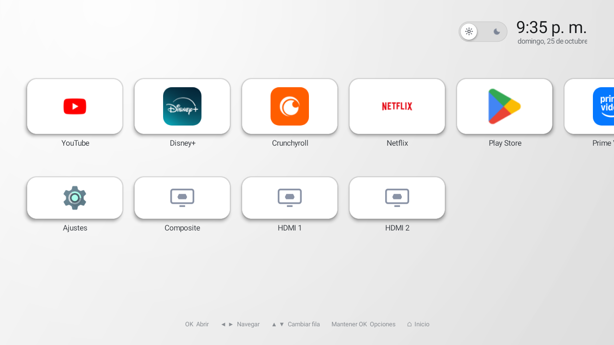
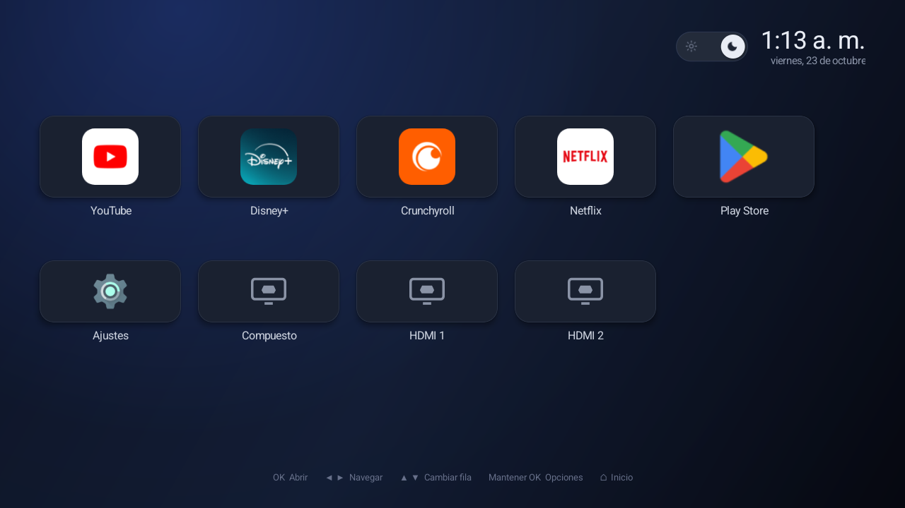

# TV Home

**A tiny, ad-free launcher for Android TV and Google TV.**

[](LICENSE)
[](#requirements)
[](#why-another-launcher)
[](#why-another-launcher)

<p align="center">
  
</p>

TV Home replaces the stock Android TV launcher with a single screen: your apps on
top, Settings and TV inputs below, and nothing else. No recommendations, no
"sponsored" rows, no banners, no telemetry.

It is a single Activity written in plain Java, built only with framework views.

---

## Why another launcher?

| | TV Home | Stock Google TV launcher |
|---|---|---|
| APK size | **~35 KB** | ~15 MB |
| Idle RAM | **~22 MB** | ~66 MB (measured on an onn. 4K) |
| Dependencies | **none** | AndroidX, Compose, Play Services… |
| INTERNET permission | **no** | yes |
| Ads / sponsored rows | **impossible** | yes |
| Accounts required | **no** | yes |

Because the app does not request `android.permission.INTERNET`, it cannot show
ads or send telemetry even if it wanted to. The only permission it asks for is
`QUERY_ALL_PACKAGES`, which Android 11+ requires to list the installed apps.

## Features

- **Light theme by default**, with a one-tap dark theme (sun/moon switch) that is
  remembered across reboots.
- **Row 1** — every app with a TV (`LEANBACK_LAUNCHER`) entry, plus sideloaded
  apps that only expose a regular launcher icon.
- **Row 2** — Settings and the TV inputs reported by `TvInputManager`
  (Composite, HDMI 1, HDMI 2…), always with a generic input icon because some
  firmwares report blank or missing icons.
- **Reorder apps** from the TV: hold **OK** on a card, choose **Move**, use ◀ ▶,
  and press OK to drop. The order is saved.
- **Long-press menu** with *Move* and *Info* (opens the system app page).
- **Horizontal carousel** that scrolls only as far as needed.
- **Live refresh** when an app is installed or uninstalled, without losing focus.
- **Focus memory**: coming back from an app returns you to the same card.
- **Clock and date** in the system's own format and locale.

## Screenshots

<p align="center">
  
  
</p>

## Requirements

- Android TV or Google TV, **Android 11 (API 30) or newer**.
- A remote with a D-pad. Touch is not required.
- Tested on:
  - onn. 4K Streaming Box — Android 14
  - Google TV 2K (Motorola) — Android 14
  - Hisense HiSmart 2K ATV4 — Android 11

## Download

Grab the latest signed APK from the
[**Releases page**](../../releases/latest) (`tv-home-x.y.apk`, ~35 KB).

No Play Store account, no login, no extra downloads.

## Install

### Option A — ADB (recommended)

```bash
adb connect <TV_IP>:5555        # or the wireless-debugging TLS port
adb install -r tv-home-1.1.apk
```

Then make it the Home app:

```bash
adb shell cmd package set-home-activity --user 0 com.bumbu.tvhome/.MainActivity
```

### Option B — From the TV

1. Copy the APK to a USB drive, or download it on the TV with a file manager
   such as *Downloader*.
2. Open the APK and allow installs from unknown sources when prompted.
3. Press **Home**. Android will ask which launcher to use; pick **TV Home** and
   choose **Always**.

You can also set it later in **Settings → Apps → Default apps → Home**.

Your stock launcher stays installed: TV Home never disables or uninstalls
anything. To go back, pick the stock launcher again (or
`adb uninstall com.bumbu.tvhome`).

## Controls

| Key | Action |
|---|---|
| ◀ ▶ | Move through the app row (scrolls automatically) |
| ▲ ▼ | Switch between the app row, the system row and the theme switch |
| OK | Open the focused app / toggle the theme |
| Hold OK | Card menu: **Move** / **Info** |
| Home | Jump back to the first card |
| Back | Does not leave the launcher; returns to the first card |

## Build from source

Requirements: **JDK 17** and **Android SDK 34** (build-tools + platform). The
Gradle wrapper is included, so you do not need Gradle installed.

```bash
cd tvhome
./gradlew assembleRelease        # gradlew.bat on Windows
```

Or open the `tvhome/` folder in Android Studio and build the `release` variant.

The output APK is `tvhome/app/build/outputs/apk/release/app-release.apk`.

### Signing

The release signing material is **not** in this repository (see `.gitignore`).
To build a signed release, create `tvhome/keystore.properties`:

```properties
storeFile=tvhome.jks
storePassword=YOUR_STORE_PASSWORD
keyAlias=YOUR_KEY_ALIAS
keyPassword=YOUR_KEY_PASSWORD
```

and put your own `tvhome.jks` next to it. Without that file the project still
builds, but the release APK will be unsigned.

## Project layout

```
.
├── tvhome/                     # Android app (Gradle project)
│   ├── app/src/main/
│   │   ├── AndroidManifest.xml
│   │   ├── java/com/bumbu/tvhome/MainActivity.java
│   │   └── res/                # drawables, backgrounds, theme
│   └── README.md               # detailed design/tech notes
├── docs/screenshots/           # images used in this README
├── mockups/                    # HTML/CSS design mocks
└── LICENSE
```

Everything UI-related lives in one file, `MainActivity.java`, including the
palette, geometry and navigation. Sizes are in dp, measured against a 1280×720
design.

## Notes

- **No network code at all.** The app cannot phone home: there is no INTERNET
  permission, no analytics SDK and no third-party library.
- **Casting and the phone remote keep working.** TV Home is only a Home
  activity; it does not touch `mediashell`, the remote service, or Google
  accounts.
- **The system launcher is never modified.** Debloating scripts are intentionally
  not part of this repository: they are device-specific, they use hardware
  serial numbers, and one wrong package can break TV settings. Use them at your
  own risk if you write your own.
- **App names, icons and logos** belong to their respective owners. TV Home only
  displays the icons that are already installed on the device.

## License

[MIT](LICENSE) © 2026 Bumbu

Not affiliated with Google, Android TV, or any app shown in the screenshots.
